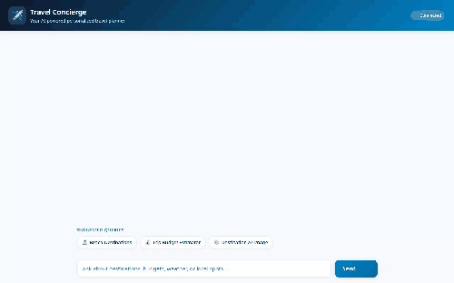

# Travel Concierge 🌴✈️

An AI-powered conversational travel concierge built with the Agent Development Kit (ADK) that helps users discover personalized travel destinations, manage preferences, calculate trip budgets, and generate rich media previews.



---

## 🌟 Implemented Features & Architecture

Travel Concierge combines Google Cloud services, ADK framework tools, and structured A2UI rendering to deliver a personalized travel planning experience:

- **Personalized Memory Bank (Firestore)**: Remembers user dietary restrictions, allergies, health facts, and travel preferences across sessions using Google Cloud Firestore (`user_memories` collection). Automatically tailors destination recommendations to user health and preference requirements.
- **Destination Catalog (Firestore)**: Stores and queries curated travel destination profiles (`destinations` collection).
- **A2UI Dynamic Interface**: Renders structured, flat UI cards and columns for destination lists, details, and recommendations via A2UI Schema Manager (`v0.8` / `BasicCatalog`).
- **AI Image Generation (Vertex AI Imagen 3)**: Generates high-resolution destination preview images using `imagen-3.0-generate-002`, saving them as local artifacts and uploading them to Google Cloud Storage.
- **AI Video Generation (Google Omni Model)**: Generates short promotional video clips using `gemini-omni-flash-preview` in the `global` region, saving them as local artifacts and uploading them to Google Cloud Storage.
- **Public Media Storage (Cloud Storage)**: Automatically uploads generated media (images & promotional videos) directly to a public Google Cloud Storage bucket and returns secure public HTTPS URLs.
- **Trip Budget Estimation (ADK Code Sandbox)**: Calculates detailed trip expenses (lodging, dining, activities, transport) using `AgentEngineSandboxCodeExecutor`.
- **Live Currency Conversion**: Converts monetary amounts between international currencies using live exchange rates from the Frankfurter API.
- **Google Maps Geocoding & Places**: Resolves street addresses/cities into geographic coordinates and discovers nearby attractions.
- **Weather & Time Lookup**: Fetches current weather info and timezone-aware current times for target travel destinations.

---

## 🛠️ Project Structure

```
travel-concierge/
├── app/
│   ├── __init__.py
│   ├── agent.py               # Main ADK Root Agent, Firestore setup, and tool definitions
│   └── a2ui_utils.py          # A2UI callback and structured response formatting
├── frontend/
│   ├── main.py                # FastAPI proxy server connecting UI to Agent Engine / local agent
│   ├── requirements.txt       # Frontend dependencies (FastAPI, uvicorn, google-adk)
│   └── static/
│       └── index.html         # Custom branded chat frontend UI
├── agents-cli-manifest.yaml   # Deployment metadata and configuration for agents-cli
├── requirements.txt           # Python dependencies for the agent codebase
├── record_demo.py             # Playwright script for automated UI demo recording
└── convert_to_gif.py          # Script for converting video demo recordings into optimized GIFs
```

---

## 🚀 Running the Project Locally

### Prerequisites

- Python 3.11+
- Google Cloud credentials with Firestore and Vertex AI access configured (`gcloud auth application-default login`)

### 1. Install Agent Dependencies

```bash
python -m venv .venv
source .venv/bin/activate
pip install -r requirements.txt
```

### 2. Configure Environment Variables

Create a `.env` file in the project root:

```bash
GOOGLE_GENAI_USE_VERTEXAI=true
GOOGLE_CLOUD_PROJECT=your-gcp-project-id
GOOGLE_CLOUD_LOCATION=us-east1
GOOGLE_MAPS_API_KEY=your-google-maps-api-key
```

### 3. Start the Agent Playground (Dev UI)

To test the agent locally using the ADK Playground:

```bash
acli playground
```

### 4. Run the Custom Frontend Locally

Navigate to the `frontend/` directory, install requirements, set the required environment variables, and start the proxy server:

```bash
cd frontend
pip install -r requirements.txt

export AGENT_ENGINE_RESOURCE_NAME="projects/YOUR_PROJECT_ID/locations/us-east1/reasoningEngines/YOUR_REASONING_ENGINE_ID"
export AGENT_DIRECTORY="app"

python main.py
```

Once running, open your web browser to port `8080` on your host machine to interact with the custom Travel Concierge interface.
